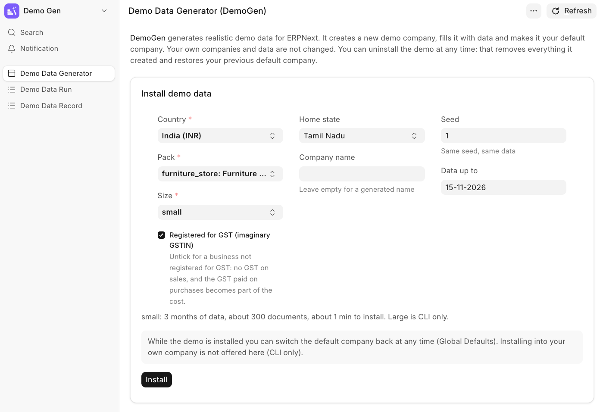
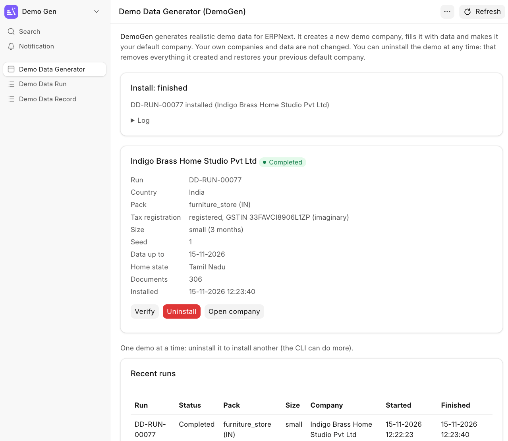

# DemoGen: Demo Generator for ERPNext

[](https://github.com/thava/erpnext_demo_gen/actions/workflows/tests-v16.yml)
[](https://github.com/thava/erpnext_demo_gen/actions/workflows/tests-develop.yml)

DemoGen is a Frappe app that fills an ERPNext site with realistic fictional business
history for demonstrations, development, and testing. Generate a demo from the command
line or the DemoGen page in Frappe Desk, explore it in ERPNext, then remove it when finished.

- Creates a demo company with quotations, orders, deliveries, invoices, payments,
  returns, stock movements, bank transfers, and office supplies.
- Uses country-specific taxes, charts of accounts, addresses, banks, and names.
- Supports registered and [unregistered businesses](#unregistered-businesses) in India, the UAE, and Germany.
- Verifies that ledgers balance, reports agree with transactions, and demo tax rules are applied.
- Removes the demo company and the data DemoGen created with one command.

By default, the demo becomes your default company until you remove it. **Removal also
deletes transactions you manually add to that demo company.** See [Removing demo data](#removing-demo-data)
for how to preserve your additions.

**Start here:** developers can use the [quick start](#quick-start); support and demo users
can use the [DemoGen page](#the-demogen-page) after an administrator installs the app.
For a ready-made medium or large demo, use a [snapshot](#snapshots).

[Requirements](#requirements) · [Customization](#customizing-a-demo) ·
[Removal](#removing-demo-data) · [Unregistered businesses](#unregistered-businesses) ·
[Country details](#countries) ·
[Demo contents](#what-the-demo-includes) · [Snapshots](#snapshots) ·
[Troubleshooting](#troubleshooting) · [Command reference](#command-reference) ·
[Development](#development) · [Disclaimer](#disclaimer)

## Requirements

- A working Bench with Frappe and ERPNext **version 16**, or both on **develop**.
- A site with the initial setup wizard completed. Choose the **same country in the
  wizard as the demo you intend to generate**. Mixing countries on one site is not
  recommended or officially supported; use a separate site for each country.
- Keep `bench start` running in another terminal while using DemoGen in a development bench.
  On a production bench, keep the equivalent managed services running.
- India demos require **India Compliance** (`india_compliance`) installed on the site.
  US, UAE, and Germany demos require a site **without** India Compliance.

A **pack** describes a type of business:

| Country | Code | Available packs |
| --- | --- | --- |
| India | `IN` | `furniture_store`, `electrical_distributor` |
| United States | `US` | `furniture_store` |
| United Arab Emirates | `AE` | `furniture_store` |
| Germany | `DE` | `furniture_store` |

<details>
<summary>Advanced: services, country dependencies, and compatibility</summary>

The CLI needs Redis running, but no worker: it runs generation and removal itself.
Desk also needs the web server and a worker listening on the `long` queue, because it
queues generation and removal as background jobs there. `bench start` starts all of
these together.

India Compliance validates shared items and parties across the site, regardless of
company country. This is why other countries' demos need a site without it.

The badges above show automated tests against version 16 and develop. Tests run on
app changes and nightly against that day's Frappe and ERPNext. Develop is a moving
branch; check the badge and snapshot release notes when using it.

</details>

## Quick start

Run Bench commands from your bench directory. Replace `demo.localhost` with your site
name. This example uses a site configured for **India**, with India Compliance installed;
for another country, use its code and a matching site.

### 1. Install the app

```bash
bench get-app https://github.com/thava/erpnext_demo_gen
bench --site demo.localhost install-app erpnext_demo_gen
```

### 2. Generate a small demo

With `bench start` running in another terminal:

```bash
bench --site demo.localhost demo-gen install --country IN --size small
```

This creates about 300 documents covering three months, usually in about a minute.
`--country` is the only required generation option; the CLI defaults to the
`furniture_store` pack and `medium` size when those options are omitted. Each generation
is a **run**, identified by a
name such as `DD-RUN-00009`. Progress and the generated company name appear in the terminal.

### 3. Verify and explore

```bash
bench --site demo.localhost demo-gen verify
```

Open your site in the browser, then open **DemoGen** from the apps screen or go to
`/desk/demo-gen`. Explore invoices, stock, accounts, and reports for the demo company.
Verification returns exit code 1 if a check fails; checks vary by country.

### 4. Remove the demo data

```bash
bench --site demo.localhost demo-gen uninstall
```

Confirm the prompt to delete the demo company, its transactions, and the records
DemoGen created, and restore the previous default company. Transactions you added to
the demo company are also deleted. To keep your additions, see [Removing demo data](#removing-demo-data).

`install-app` installs the Frappe app. `demo-gen install` generates data;
`demo-gen uninstall` removes that data and leaves the app installed.

<details>
<summary>Example CLI output: generation, verification, and removal</summary>

These shortened examples show a medium Indian demo. Counts and timings vary.

```bash
bench --site demo.localhost demo-gen install --country IN
```

```text
Pack: furniture_store (its default pack), country: India (IN), currency INR
Started DD-RUN-00009
Setting up the company, warehouses, fiscal years and bank accounts...
Company: Indigo Brass Home Studio Pvt Ltd
Plan: 1196 documents
Writing them takes about 4 min; please wait. Progress is shown every 20 s. ...
  201 of 1196 documents written (16%), 20 s so far, about 2 min left
  ...
DD-RUN-00009 completed: 1210 documents in Indigo Brass Home Studio Pvt Ltd after 5 min
Check it with: demo-gen verify. Remove it with: demo-gen uninstall.
```

- Each install is a *run* with its own number (`DD-RUN-00009`).
- The run creates a new company. Its name is made up (here "Indigo Brass Home Studio Pvt Ltd").
- The size is `medium` by default: 12 months of data, about 1,200 documents.

Check the result:

```bash
bench --site demo.localhost demo-gen verify
```

```text
DD-RUN-00009 (Indigo Brass Home Studio Pvt Ltd)
  ok   trial balance balances: debit - credit = 0.00
  ok   receivable aging matches outstanding: report 1,886,615.00, invoices 1,886,615.00, ...
  ok   no negative stock: 0 ledger rows below zero
  ok   taxable documents have GST rows: all present
  ok   payments use every planned mode: Card - ICICI: 16, Cash: 31, Cheque: 27, ...
  ...
19/19 checks passed
```

- `verify` exits with code 1 if any check fails, so scripts and CI can use it.
- The checks depend on the country. For example, Germany adds VAT checks.

Remove it:

```bash
bench --site demo.localhost demo-gen uninstall
```

```text
Delete demo data of DD-RUN-00009 (Indigo Brass Home Studio Pvt Ltd)? [y/N]: y
Deleting transactions of Indigo Brass Home Studio Pvt Ltd (Transaction Deletion Record)
Deleting the demo's customers, suppliers, items and other setup records...
DD-RUN-00009 uninstalled after 29 s
```

</details>

## The DemoGen page

After an administrator installs the app, users with the **System Manager** role can
open **DemoGen** from the apps screen or visit `/desk/demo-gen`. The user who completes
the setup wizard also receives a notification pointing to it.

1. Choose the site's country, pack, and size (`small` or `medium`). Adjust optional settings as needed.
2. Select **Install** and watch the progress and log. A stopped generation can be resumed.
3. Select **Verify** to check the result, or **Open company** to inspect the company.
4. Select **Uninstall** to remove the demo; type the company name to confirm.



The **Registered for tax** option is on by default; untick it for an
[unregistered business](#unregistered-businesses) in India, the UAE, or Germany.

The page shows the active demo's company, tax registration, data period, document count,
and recent runs. It handles one demo at a time. **Large demos, snapshots, reusing your
own company, and advanced removal options are CLI-only.**

<details>
<summary>View a completed demo</summary>



</details>

The page asks for confirmation when an action needs the CLI's `--force` option.
Generation and removal jobs run one at a time per site. The page’s Help shows the
corresponding CLI commands; the **Demo Data Run** list contains all runs and their events.
If it shows “Waiting for a background worker,” see [Troubleshooting](#troubleshooting).

### Updating the app

After updating the app, restart workers with `bench restart`; in development, stop and
restart `bench start`. Workers retain loaded code, so the page refuses jobs when its
worker code is older than the app's files.

## Customizing a demo

The examples below are alternatives. Use a site configured for the country shown,
and remove the active demo before generating a different one.

### Choose the country

`--country` takes a code or a name. Case, spaces and hyphens do not matter.

```bash
bench --site demo.localhost demo-gen install --country IN          # or india
bench --site demo.localhost demo-gen install --country US          # or USA, "United States", united-states
bench --site demo.localhost demo-gen install --country AE          # or UAE, united-arab-emirates
bench --site demo.localhost demo-gen install --country Germany     # or DE, Deutschland
```

- There is no default country. The country decides the tax rules, so you always choose it.
- Use the country selected in the site's initial setup wizard. Mixed-country sites are not officially supported.

<details>
<summary>Choose the pack</summary>

List the packs:

```bash
bench --site demo.localhost demo-gen list-packs
```

```
Pack                     Countries       Sizes                  Title
electrical_distributor   IN              small, medium, large   Electrical Equipment Distributor
furniture_store          AE, DE, IN, US  small, medium, large   Furniture Store; ...
Default pack per country: AE furniture_store, DE furniture_store, IN furniture_store, US furniture_store
```

```bash
bench --site demo.localhost demo-gen install --country IN --pack electrical_distributor
bench --site demo.localhost demo-gen install --country IN      # furniture_store, the default for India
```

- `--pack` is optional. Each country has a default pack.
- One pack can exist in several countries. The country is not part of the pack name.

</details>

### Choose the size

The CLI defaults to `medium`; the Desk form starts with `small`.

```bash
bench --site demo.localhost demo-gen install --country US --size small    # 3 months, about 300 documents, 1 minute
bench --site demo.localhost demo-gen install --country US                 # medium: 12 months, about 1,200 documents, 5 minutes
bench --site demo.localhost demo-gen install --country US --size large   # 24 months, about 19,000 documents, 1 to 2 hours
```

- `small` is for quick tests and bug reports. It still has every kind of document
  the demo makes, but few customers and items.
- `medium` is the default and suits most demos.
- `large` looks like a real business, but takes an hour or more.
  [Download a ready-made snapshot](#download-a-ready-made-snapshot) instead, and restore it in seconds.
- Times for every pack are under [Sizes](#sizes).

### Get the same data again, or different data

```bash
bench --site demo.localhost demo-gen install --country IN --seed 7
```

- The seed picks the names, items, customers and amounts. The default is 1.
- With the same app and pack version, seed, options, and explicit `--end-date`,
  the planner reproduces the same demo scenario. Record names can depend on existing site data.
  Without `--end-date`, the data ends today, so dates shift from day to day.
- A different seed changes the generated names and data.

```bash
bench --site demo.localhost demo-gen install --country IN --end-date 2026-03-31
```

- Data ends on `--end-date`. The default is today.
- `2026-03-31` ends the data at the close of India's fiscal year.

<details>
<summary>Name the demo company</summary>

```bash
bench --site demo.localhost demo-gen install --country US --demo-company-name "Lone Star Furniture Inc"
# Creates the company "Lone Star Furniture Inc" and makes it the default company.

bench --site demo.localhost demo-gen uninstall --yes
# Deletes "Lone Star Furniture Inc" and restores the default company you had before.
```

- Without `--demo-company-name`, the name is made up from the seed.

</details>

<details>
<summary>Choose the home state</summary>

The demo company's address is in the pack's home state. Change it with `--home-state`:

```bash
bench --site demo.localhost demo-gen install --country IN --home-state MH         # Maharashtra (default: Tamil Nadu)
bench --site demo.localhost demo-gen install --country IN --home-state 27         # the same, by GST state code
bench --site demo.localhost demo-gen install --country AE --home-state SH         # Sharjah (default: Dubai)
bench --site demo.localhost demo-gen install --country DE --home-state HH         # Hamburg (default: Bayern)
```

- India: any state or union territory, by name ("Maharashtra"), two-letter code (MH)
  or GST state code (27).
- Customers outside the home state, and suppliers, are placed in the larger
  commercial states.
- UAE: an emirate (DU, AZ, SH, AJ, RK, FU, UQ) or its name.
- Germany: a Bundesland (BY, BE, HH, NW, BW, HE, NI, SN, RP, SH) or its name.
- US: home state fixed to `TX` (Texas), with sales only within Texas. Purchases from
  other US states are supported; see [United States](#united-states).
- Most customers are in the home state; suppliers are spread wider, as for a real business.

</details>

<details>
<summary>A site that is already in use</summary>

If the site already has transactions, install stops and explains:

```bash
bench --site demo.localhost demo-gen install --country IN
```

```
This site already has transactions:
  Kaveri Traders (default company): 42 documents, 180 GL entries
The demo goes into a new, separate company (a peer, not a child company) and
does not change these. It becomes the default company while installed;
uninstall deletes it and restores the current default.
This is safe, but because the site is in use, installing needs --force.
```

```bash
bench --site demo.localhost demo-gen install --country IN --force
```

- `--force` is also needed when the GST API is on (India), or with `--unregistered`.

</details>

<details>
<summary>Stop and resume</summary>

```bash
bench --site demo.localhost demo-gen install --country US --size large
# ... press Ctrl+C, or the machine restarts ...
bench --site demo.localhost demo-gen install --country US --size large
# The same command resumes where it stopped.
```

If you resume on a later day and originally omitted `--end-date`, pass the original
run’s end date explicitly. Otherwise “today” changes the inputs. Desk’s **Resume install**
uses the saved inputs automatically.

</details>

<details>
<summary>See every document created</summary>

```bash
bench --site demo.localhost demo-gen install --country AE --verbose
# At the end, prints how many documents of each doctype were created.
```

A **DocType** is a Frappe record type, such as Sales Invoice or Customer.
Created records are tracked in the *Demo Data Record* list under their *Demo Data Run*.
Uninstall uses that record, together with ERPNext's Transaction Deletion Record.

</details>

<details>
<summary>Status, history, and run IDs</summary>

### See what is installed

```bash
bench --site demo.localhost demo-gen status
```

```
DD-RUN-00009  Completed: furniture_store (IN)/medium seed 1, data up to 2026-11-11, company Indigo Brass Home Studio Pvt Ltd
    1210 documents; since 2026-11-11 04:40
Runs on this site: 9 (1 completed, 8 uninstalled). Details: demo-gen history
```

```bash
bench --site demo.localhost demo-gen history --limit 4
```

```
2026-11-11 04:40  DD-RUN-00009  installed after 5 min (Created 187, Submitted 1023)
2026-11-11 04:36  DD-RUN-00009  install started: furniture_store (IN)/medium seed 1, ...
2026-11-10 04:25  DD-RUN-00008  uninstalled after 17 s (Deleted 286)
2026-11-10 04:24  DD-RUN-00008  uninstall started
... 30 older events (--limit)
```

```bash
bench --site demo.localhost demo-gen history --run DD-RUN-00009   # one run, with counts per doctype
```

</details>

## Removing demo data

Default removal deletes the demo company’s transactions, then removes the company
and the records DemoGen created. It restores your previous default company and leaves
the app installed.

```bash
bench --site demo.localhost demo-gen uninstall
```

**Any transactions you added to the demo company are also deleted.** To preserve your
additions, use the slower registry-based removal:

```bash
bench --site demo.localhost demo-gen uninstall --registry-only
```

Customers, suppliers, and items you created yourself are shared site records and are
left alone. Accounts, cost centers, and warehouses inside the demo company go when
that company goes. Add `--yes` to skip the confirmation prompt in scripts.

<details>
<summary>Advanced: how removal works and what happens to linked records</summary>

Uninstall can remove a demo company in two ways.

**Default: faster, and removes everything in the demo company.**

```bash
bench --site demo.localhost demo-gen uninstall
```

- Deletes every transaction in the demo company with ERPNext's Transaction Deletion
  Record, including transactions you created yourself while exploring.
- Then deletes the demo's own customers, suppliers, items, accounts and other records,
  and the company.
- Takes seconds to a few minutes: about 20 seconds for medium, about 2 minutes for large.
- Needs the Redis queue (`bench start`), as the Transaction Deletion Record does.

**`--registry-only`: slower, and keeps what you created.**

```bash
bench --site demo.localhost demo-gen uninstall --registry-only
```

- Deletes only the demo's own documents, one by one, newest first, from its record of
  what it created (the Demo Data Record list). Each goes with its ledger rows; nothing is
  cancelled, so no reversal entries are made.
- Then deletes the demo's own customers, suppliers, items, accounts and the company, like
  the default, except those your own documents still refer to. For example, if you
  recorded a payment against a demo invoice, that invoice, its customer and the company
  are kept. Uninstall lists everything it kept.
- If you added nothing, it ends the same as the default, only slower: about 5 minutes for
  medium, about 80 minutes for large.
- This deletion path does not itself need the Redis queue; keep the normal Bench services running for DemoGen usage.

In both ways, customers, suppliers and items you created yourself are never deleted
(they don't belong to a company). Accounts, cost centers and warehouses you added inside
the demo company go when the company goes.
`--use-wizard-company` runs are always removed the `--registry-only` way.

If your own records refer to demo records, registry-based removal retains those demo
records and reports them. Resolve those references and retry removal to finish cleanup.
This is an exception caused by additions to the demo, rather than the normal removal flow.

</details>

<details>
<summary>Advanced: select a run</summary>

```bash
bench --site demo.localhost demo-gen uninstall --run DD-RUN-00009
```

- Without `--run`, uninstall removes the only active run.
- `verify --run DD-RUN-00009` checks one run the same way.

</details>

<details>
<summary>Advanced: generate data in your existing company</summary>

By default the demo gets a new company. `--use-wizard-company` uses the company
selected as the site’s default company instead (normally the company made by the setup wizard):

```bash
bench --site demo.localhost demo-gen install --country DE --use-wizard-company
# Adds the demo's documents to your default company.
# --force is needed only if that company already has transactions.

bench --site demo.localhost demo-gen uninstall
# Backs up the site first, as bench drop-site does.
# Then removes only the demo's documents, one by one.
# Keeps (and lists) any demo document that your own documents refer to.
```

```bash
bench --site demo.localhost demo-gen uninstall --no-backup     # skip the backup
```

The company must not have a tax ID. Demo invoices are issued under the company's
tax ID, so DemoGen never uses a real one:

```bash
bench --site demo.localhost demo-gen install --country AE --use-wizard-company
# Error: My Company LLC has a tax ID (Company Tax ID); DemoGen never uses a real one.
# Install without --use-wizard-company to get a new demo company.
```

- Tax ID means the company's *Tax ID* field in every country. In India also its GSTIN:
  on the company, or on one of its own addresses.
- A new registered demo company gets an imaginary tax ID (valid format and check digit).
  An unregistered demo company has no tax ID.

Country notes:

- Germany: the company must use the SKR04 chart (*SKR04 mit Kontonummern*).
- India: GST needs a GSTIN, so the demo adds a company address with an imaginary one,
  titled "(demo, fictitious GSTIN)". Uninstall removes it. To leave GST out instead:

```bash
bench --site demo.localhost demo-gen install --country IN --use-wizard-company --unregistered --force
# Treats the company as not registered for GST. No address is added.
# See "Unregistered businesses" below.
```

</details>

## Unregistered businesses

This section describes what the demo does. It is not tax advice; see the [Disclaimer](#disclaimer).

**DemoGen supports businesses not registered for GST/VAT in India, the UAE, and
Germany.** Use `--unregistered --force` in the CLI, or untick **Registered for tax**
in Desk and confirm. Registered is the default. The US/Texas demo does not support
this option: its business sells taxable goods and requires a sales tax permit.

These demos charge no GST/VAT on sales, but purchases can still include tax charged
by suppliers. That purchase tax cannot be claimed back: DemoGen configures tax
accounts and templates so it becomes part of stock cost or an expense, as appropriate.
The country-specific configuration, template selection, and verification checks are below.

The demo keeps the pack's normal business volume, which exceeds the modeled
registration thresholds. This is why generation requires `--force` or Desk confirmation.
The option demonstrates the accounting treatment; it does not reduce the demo's turnover.

### Purchase tax categories: Valuation, Total, and Valuation and Total

ERPNext's **Consider Tax or Charge for** field controls whether a purchase tax or
charge affects stock valuation, the document total, or both:

| Category | Included in stock valuation | Included in document total |
| --- | --- | --- |
| `Valuation` | Yes | No |
| `Total` | No | Yes |
| `Valuation and Total` | Yes | Yes |

For non-recoverable tax billed by a supplier on stock items, DemoGen uses
**Valuation and Total**: the tax increases both the stock cost and the amount owed
to the supplier. Using Valuation alone would omit the tax from the document total;
using Total alone would not include it in stock valuation. For non-stock purchases,
such as drinking water, ERPNext changes the category to **Total**, and the tax is
an expense rather than part of stock value. The account and tax templates determine
the accounting treatment; the category alone does not mean a tax is recoverable.

### India: unregistered businesses (no GST)

Many small Indian businesses are not registered for GST. This demo can show one:

```bash
bench --site demo.localhost demo-gen install --country IN --unregistered --force
```

ERPNext and india_compliance do not handle this case by themselves.
The demo does the set-up that such a business has to do by hand:

- With no GSTIN, india_compliance turns off all its GST logic.
- Sales carry no GST. That is right: an unregistered business does not charge it.
- Purchases from GST-registered suppliers **still include GST**.
- The business cannot claim that GST back (no input tax credit).
  So the GST is part of what the goods cost.
- ERPNext does not add it by default. Without the set-up below, the purchase
  has no GST, and the amount owed to the supplier is too low.

**Set-up: an expense account and templates without ITC.** The demo creates these.
A real unregistered company would need a similar set-up:

```
Account                 GST Not Recoverable        (Expense Account, under Indirect Expenses)
Purchase template       Input GST (not recoverable)
  one row               account GST Not Recoverable, Consider Tax or Charge for:
                        Valuation and Total, Add, On Net Total, rate 18
Item Tax Templates      GST 5% (not recoverable), 12%, 18%, 28%
  one row each          account GST Not Recoverable, rate = the full GST rate
Items                   use those Item Tax Templates, so each item's own rate applies
```

Why not india_compliance's Input Tax CGST/SGST/IGST accounts: they hold GST you can
claim back. An unregistered business cannot, so its GST must never land there.

What "Valuation and Total" does with each kind of purchase:

```
stock items (furniture, paper)    GST goes into the item's cost: stock value, then
                                  cost of goods sold when the item is sold
non-stock items (drinking water)  ERPNext changes the row to "Total" (no stock value to
                                  add it to), so the GST is an expense when bought
```

This is the usual treatment: tax you cannot claim back is part of what goods cost
(in India, section 145A of the Income-tax Act). The CGST/SGST/IGST split is not
kept, since an unregistered business does not report it. GST is the same rate in-state
and out-state, so one template covers both.

**Using the template:**

- On a purchase order or invoice from a GST-registered supplier, pick
  "Input GST (not recoverable)".
- Receipts and invoices made from the order copy the tax rows.
- Purchases from unregistered suppliers get no template.

**Letting ERPNext pick the template.** Add a *Tax Rule* (Tax Type: Purchase, your
company, template: Input GST (not recoverable)).

- A rule matches only suppliers with the same Tax Category (empty matches empty).
- Give unregistered suppliers a Tax Category such as "Unregistered". Then the rule
  does not apply to them.
- Do not just mark the template as the default. It would add GST to purchases from
  unregistered suppliers too.

**Other rules the demo follows:**

- **Customers only in your state.** An unregistered business cannot sell to another
  state, or to an SEZ: that needs GST registration at any turnover.
  The demo uses Tamil Nadu as the home state, as an example, and puts every customer
  in Tamil Nadu. With `--home-state MH`, every customer is in Maharashtra instead.
  Suppliers can be anywhere.
- **Turnover above the threshold.** The demo uses the pack's normal volume. That is above
  the registration threshold (Rs 40 lakh a year for goods; Rs 20 lakh in special-category
  states). Install prints a warning: a real business that size must register.
- **Your own company.** With `--use-wizard-company --unregistered`, the account and the
  templates are created in your company. Uninstall removes them, unless your own documents use them;
  those are kept and listed. To keep using them after uninstall, make your own copies.
- `verify` checks that sales carry no GST, and that purchases from registered
  suppliers carry GST only on GST Not Recoverable.

### UAE: unregistered businesses (no VAT)

```bash
bench --site demo.localhost demo-gen install --country AE --unregistered --force
```

A business below the registration threshold (AED 375,000 of taxable supplies in 12
months; voluntary from AED 187,500) does not charge VAT and has no TRN. VAT that its
suppliers charge cannot be recovered. The demo sets it up the way India's unregistered
case does (see [India: unregistered businesses](#india-unregistered-businesses-no-gst)):

```
Account             VAT Not Recoverable  (Expense Account, under Indirect Expenses)
Purchase template   UAE VAT 5% (not recoverable): one "Valuation and Total" row, 5%,
                    on that account; used for suppliers with a TRN
                    stock items: VAT in their cost; non-stock items: an expense
Empty templates     "No VAT (not registered)" for sales and for suppliers without a TRN,
                    so ERPNext does not apply the default "UAE VAT 5%"
Not used            UAE VAT Settings, VAT Emirate, recoverable expenses, VAT 201
```

- `--force` is needed: the demo's turnover is above the threshold, and install warns.
- `verify` checks that sales carry no VAT, and that purchase VAT is only on
  VAT Not Recoverable. The VAT 201 checks are skipped.

### Germany: Kleinunternehmer (no VAT)

```bash
bench --site demo.localhost demo-gen install --country DE --unregistered --force
```

A Kleinunternehmer (§ 19 UStG) charges no VAT and cannot deduct input VAT. Since 2025
the limits are net turnover of at most EUR 25,000 in the previous year and EUR 100,000
in the current year. The demo sets it up like this:

```
Sales               no VAT: an empty template "Kleinunternehmer (keine Umsatzsteuer)"
                    stops ERPNext's default; income to 4185 "Erlöse aus Kleinunternehmer
                    i. S. d. § 19 Abs. 1 UStG" (the demo's items default to it)
Invoice note        Terms and Conditions "Kleinunternehmerregelung (§ 19 UStG)" on every
                    quotation, order and invoice: "Gemäß § 19 UStG enthält der
                    ausgewiesene Rechnungsbetrag keine Umsatzsteuer."
Account             Nicht abziehbare Vorsteuer (Kleinunternehmer)  (Expense Account, under
                    7 - sonstige betriebliche Aufwendungen)
Purchase template   Lieferung aus dem Inland (Vorsteuer nicht abziehbar): one "Valuation
                    and Total" row on that account; stock items: VAT in their cost
                    (§ 9b EStG); non-stock items: an expense
Item Tax Templates  "19 % (nicht abziehbar)", "7 % (nicht abziehbar)", on each item under
                    the Tax Category "Vorsteuer nicht abziehbar"
Tax Category        set on every purchase (German suppliers charge VAT with or without
                    an USt-IdNr.), so only purchases pick the item's rate; sales lines get none, and "Automatically add
                    Taxes and Charges from Item Tax Template" can stay on
Company             no USt-IdNr. (a Kleinunternehmer still has a Steuernummer; not modelled)
```

- `--force` is needed: the demo's turnover is far above the limits, and install warns.
- `verify` checks that sales carry no VAT and carry the note, and that bills carry
  non-deductible VAT at each item's rate (19 % / 7 %). The UStVA checks are skipped.

## Countries

For businesses without GST/VAT registration, see [Unregistered businesses](#unregistered-businesses).

Each demo models a specific local business scenario. Expand a country for tax setup,
registration options, and limitations. These notes describe what the demo does. They are
not tax advice; see the [Disclaimer](#disclaimer).

### India

<details>
<summary>Demo setup and tax details</summary>

```bash
bench --site demo.localhost demo-gen install --country IN                                  # furniture showroom
bench --site demo.localhost demo-gen install --country IN --pack electrical_distributor    # electrical wholesaler
```

- The demo company is in Tamil Nadu, as an example. Pick another state with `--home-state`.
- GST through india_compliance: CGST and SGST in the home state, IGST across states.
- Each item's GST rate comes from its Item Tax Template.
- Two demo bank accounts, UPI and card receipts, weekly transfers.
  See the banking details under [What the demo includes](#what-the-demo-includes).
- For `--unregistered`, see [India: unregistered businesses](#india-unregistered-businesses-no-gst).

</details>

### United States

The US demo uses **Texas (`TX`) as its fixed home state and sells only within Texas**.
Purchases from suppliers in other US states are supported. This setup was chosen for
its simpler in-state sales tax scenario. Other home states and interstate sales are
outside the demo's scope: their tax requirements add complexity and often involve
third-party services such as TaxJar.

<details>
<summary>Demo setup and tax details</summary>

```bash
bench --site demo.localhost demo-gen install --country US
```

- A Texas furniture showroom, with a trade channel (designers and projects).
- The demo sells only in Texas, so every sale is taxed at 8.25%.
  That is 6.25% state tax plus the 2% local maximum (Austin: 1% city, 1% transit).
- The rate is fixed in the pack (`sales_tax` in `us_trading.yaml`). It is never fetched
  from a tax service.

What the install sets up:

```
accounts        Texas Sales Tax Payable, Texas Use Tax Payable (Duties and Taxes)
                Sales Tax Paid, Use Tax Expense (Indirect Expenses)
sales           "TX Sales Tax 8.25%" (default); "TX Exempt Sale" for resellers
purchases       "TX Resale Purchase (certificate)": stock for resale, no tax
                "TX Tax Charged 8.25%" (default): own-use bills from Texas sellers
                "TX Use Tax 8.25%": own-use bills from out-of-state sellers; adds the tax
                to expense and owes it to Texas (Add and Deduct rows)
items           "TX Exempt - Food" Item Tax Template (coffee, bottled water)
categories      Tax Categories "Reseller" and "Out of State", with Tax Rules, so
                documents you create by hand pick the same templates
```

- Reseller customers have a Texas resale certificate number and buy tax-free.
- Out-of-state suppliers have the "Out of State" tax category.
- ERPNext's own US templates (US ST 6% and others) stay, but are no longer the defaults.
- Payments: Check, ACH, Wire Transfer and Card. Account and routing numbers are made up.
- The fiscal year runs January to December.
- `--unregistered` is refused: a Texas business selling taxable items needs a sales tax
  permit, with no small-business threshold. `--home-state` accepts only TX.

</details>

### United Arab Emirates

<details>
<summary>Demo setup and tax details</summary>

```bash
bench --site demo.localhost demo-gen install --country AE
```

- A VAT-registered furniture showroom in Dubai (an example; `--home-state` picks another
  emirate), with a trade channel (fit-out, hospitality, projects).
- It uses ERPNext's own UAE set-up.

```
VAT             5% on sales and purchases ("UAE VAT 5%", made the default templates),
                with input credit; shelf prices include VAT (UAE consumer rules)
VAT Emirate     each sale's VAT Emirate (VAT 201 boxes 1a-1g) comes from the company
                address's Emirate field, which the install sets to Dubai
recoverable     every purchase bill records its VAT as "Recoverable Standard Rated
                Expenses" (VAT 201 box 9)
suppliers       one without a TRN is not registered and charges no VAT: its bills use an
                empty template, "No VAT (supplier not registered)"
UAE VAT Settings  lists the company's VAT account (reverse charge and VAT 201 use it)
parties         TRNs (15 digits) for VAT-registered businesses; emirates as states,
                P.O. Boxes, +971 numbers
banking         Emirates NBD and Mashreq accounts with valid-format IBANs; wire
                transfer, cheque, card (collection account) and cash; AED
```

- `verify` runs ERPNext's UAE VAT 201 report. It checks that boxes 1 and 9 match the invoices.
- Not covered: imports and reverse charge, zero-rated exports, tourist refunds,
  excise, designated zones.

</details>

### Germany

<details>
<summary>Demo setup and tax details</summary>

```bash
bench --site demo.localhost demo-gen install --country DE
```

- A VAT-registered furniture store (GmbH) in Munich (an example; `--home-state` picks
  another Bundesland), with a trade channel (interior designers, hotels, office fit-out).
- It uses the SKR04 chart and ERPNext's own German tax set-up.

```
chart           SKR04 mit Kontonummern; ERPNext creates its tax templates with the company
VAT             sales "Lieferung oder sonstige Leistung im Inland", purchases "Lieferung
                aus dem Inland": rows for 19 % and 7 % at rate 0; each item's Item Tax
                Template ("19 %", "7 %") sets the rate, so one invoice can mix both
rates           furniture 19 %; staff coffee 7 % (food); bottled water 19 %
prices          shop prices include VAT (Preisangabenverordnung)
defaults        income, receivable, payable, cash and expense defaults set to the usual
                SKR04 ledgers (4400, 1200, 3300, 1600, 5200) where ERPNext picked others
parties         USt-IdNr. (valid check digit) for VAT-registered businesses; Bundesländer,
                5-digit postcodes, +49 numbers
banking         Stadtsparkasse München and Deutsche Bank accounts with valid-format IBANs;
                SEPA transfer, SEPA direct debit, card (collection account) and cash; EUR
```

- `verify` checks that each invoice's VAT matches its items' rates.
- It checks that the 7 % items are billed at 7 %.
- It checks that the VAT accounts match the invoices (the UStVA totals:
  output VAT, input VAT, payable).
- The install fills each order's tax rows itself. So ERPNext's setting "Automatically add
  Taxes and Charges from Item Tax Template" (on by default) can stay on.
- `--use-wizard-company` needs a company on the SKR04 chart.
- Not covered: EU and non-EU trade (reverse charge), Kleinunternehmer suppliers,
  DATEV export, e-invoicing (XRechnung, ZUGFeRD).

</details>

## Tax registration

<details>
<summary>Fictional tax IDs and registration details</summary>

A registered demo company gets imaginary tax IDs (valid format and check digit), shown where
ERPNext shows them and summed up in the company's *Registration Details*:

```
India     GSTIN on the company address and on the Company (GST Category "Registered
          Regular"); PAN in Registration Details
UAE       TRN as the Company's Tax ID
Germany   USt-IdNr. as the Tax ID; a Steuernummer in Registration Details
US        EIN as the Tax ID; the Texas sales and use tax permit (taxpayer number) in
          Registration Details, since ERPNext has no field for it
```

A new unregistered demo company (`--unregistered`, or the unticked option on the page)
has no tax ID, and its Registration Details says so.

**Using your own company (`--use-wizard-company`) requires it to have no existing tax ID.**
For India, this includes a GSTIN on the Company record or any of its own addresses.
DemoGen refuses installation if one is present, even with `--force`; it never overwrites
an existing GSTIN. The existing ID must be manually removed before that company can
be used for the demo, or you can generate a separate demo company instead.

For an eligible Indian company without a GSTIN, DemoGen adds an imaginary GSTIN for
the registered demo and removes that demo GSTIN on uninstall. With `--unregistered`,
it adds no GSTIN. The company's existing Registration Details text is left unchanged.

</details>

## What the demo includes

Every size includes sales and purchases, draft and submitted documents, payments,
returns, stock movements, office supplies, bank transfers, and reconciliation.
Use ERPNext’s standard lists and reports to explore the demo company.

<details>
<summary>Office supplies and replenishment</summary>

Every pack also buys supplies for its own use, as any business does:

- Copier paper, toner, pens, registers, cleaning supplies, tea or coffee.
- They are counted in their own warehouse ("Office Stores"), with reorder levels.
- Drinking water is billed monthly.

Each month:

1. A department raises a Material Request (Material Issue).
2. A Stock Entry issues the supplies.
3. The cost goes to Print and Stationery, or Office Maintenance Expenses.

When an item reaches its reorder level:

1. A purchase Material Request follows the next day, as ERPNext's daily reorder job would raise it.
2. Then come the purchase order, the receipt and the bill.

The reorder job itself does not run during an install. To see it work afterwards, turn on
"Raise Material Request when stock reaches re-order level" in Stock Settings.

</details>

<details>
<summary>Banks, payment modes, transfers, and reconciliation</summary>

Every demo company gets two bank accounts of its own, in every country:

- a **main account**, at the bank that lends to the company;
- a **collection account**, where the shop's card terminal (and in India, the UPI QR code) settles.

The banks per country:

```
India            main: HDFC Bank                collection: ICICI Bank
United States    main: Frost Bank               collection: Wells Fargo Bank
UAE              main: Emirates NBD             collection: Mashreq Bank
Germany          main: Stadtsparkasse München   collection: Deutsche Bank
```

For example, the German demo creates:

```
Current A/c (demo) - Stadtsparkasse München      # main account
    ledger: Stadtsparkasse München Current A/c (demo)
Collection A/c (demo) - Deutsche Bank            # collection account
    ledger: Deutsche Bank Collection A/c (demo)
```

- The bank names are real. Account numbers are made up, but in the right format
  (IFSC in India, routing numbers in the US, IBANs in the UAE and Germany).
- If the site already has bank accounts, the demo never reuses them. It always creates its own.
- If a name is taken, the new one becomes "... B", "... C", and so on.
- Uninstall removes the demo's bank accounts and ledgers.
- Each bank account links to a *Bank* record, which holds just the bank's name
  (for example "Deutsche Bank"). The demo creates the record if the site has none,
  and uninstall removes it. If the site already has one, the demo links to it
  and uninstall leaves it in place.

**Weekly transfers.** Every Monday:

- The collection account's balance moves to the main account (an Internal Transfer).
- Cash taken at the counter is deposited into the main account.
- Weeks with no such receipts get no transfer.

**Payment modes.** Card payments use a mode named after the collection bank, such as
"Card - DB" in Germany. ERPNext links a *Mode of Payment* to one account per company,
and point-of-sale entries cannot pick another, so naming the mode after the account is
how a business receives payments into two accounts.

How customers and suppliers pay, per country (set per pack under `banking.modes`):

```
India            counter: Cash, UPI, Card       customers: NEFT/RTGS, cheque, UPI
                 suppliers: NEFT/RTGS, a few cheques and UPI
United States    counter: Cash, Card            customers and suppliers: ACH, Check, Wire Transfer
UAE              counter: Cash, Card            customers and suppliers: Wire Transfer, Cheque
Germany          counter: Cash, Card            customers and suppliers: SEPA transfer, SEPA direct debit
```

- Modes the site lacks are created, and removed on uninstall.
- Each bank payment has a realistic reference number (for example a cheque number).

**Bank reconciliation.**

- Both accounts are reconciled up to the end of the month before the demo's end date.
- Those payments have a clearance date, a few days after the payment,
  depending on the mode. For example, in India: UPI the same day, NEFT within a day,
  cards in one or two days, cheques in two to five.
- Later payments are not cleared yet. So the *Bank Reconciliation Statement* and
  *Bank Reconciliation Tool* show realistic open items for each account.
- Not modelled yet: card fees and a card-settlement clearing account.
  Card payments reach the collection account directly, one or two days later.

### India: UPI and the RBI rule

- The showroom has a UPI QR code and a card terminal. Both settle into the ICICI collection account.
- Credit customers also pay by UPI, to the bank details on the invoice (the HDFC main account).
- So India has three named modes:

```
UPI - ICICI     counter QR code
Card - ICICI    counter card terminal
UPI - HDFC      credit customers paying to the invoice's bank details
Cash, Cheque, Wire Transfer    ERPNext's own modes; go to the main account
```

- Card networks (Visa, Mastercard, RuPay) are not separate modes. The receiving bank is what matters.
- UPI receipts are sometimes entered as Wire Transfer. Separate modes keep them apart in reports.
- UPI is used up to Rs 1 lakh, by business customers too.
  Larger payments go by NEFT, or RTGS from Rs 2 lakh.
- References: a 12-digit RRN for UPI and cards, a NEFT or RTGS UTR, or a 6-digit cheque number.
- The UPI reference (the RRN on bank statements) goes in Reference No.
  Bank statement import and reconciliation can then match it.
- Payment-gateway apps (Razorpay, PhonePe, PayU and others) can create these payment
  entries automatically. They are separate apps, not part of ERPNext or this demo.

Why two banks? The weekly transfer is a common pattern. It also matches RBI rules:
a business with bank loans of Rs 5 crore or more may keep only a *collection* account
at a bank that does not lend to it, and that account must pass its money on to the
lending bank promptly.

</details>

## Sizes

| Size | History | Typical use |
| --- | --- | --- |
| `small` | 3 months | Quick tests and bug reports; generate directly |
| `medium` | 12 months | Most demos; generate or restore a snapshot |
| `large` | 24 months | Larger datasets; prefer a snapshot to save generation time |

CLI generation defaults to `medium`; the Desk form starts with `small`.
Counts and timings depend on the pack and machine.

<details>
<summary>Document counts, measured timings, and scenario coverage</summary>

Measured on a laptop (MariaDB in Docker). ERPNext takes about 0.3 to 0.4 s to submit
each document, so time grows with the number of documents.

| Pack / country | Small: documents / time | Medium: documents / time | Large: documents / time |
| --- | --- | --- | --- |
| Furniture / India | ~290 / 1.2 min | ~1,200 / 5 min | ~18,500 / 1.5 h |
| Electrical distributor / India | ~320 / 1.4 min | ~1,500 / 6 min | ~23,300 / 2–2.5 h |
| Furniture / US | ~300 / 1 min | ~1,200 / 5 min | ~19,000 / 1.7 h |
| Furniture / UAE | ~300 / 1 min | ~1,200 / 5 min | ~18,900 / 1 h (CI) |
| Furniture / Germany | ~310 / 1 min | ~1,200 / 4 min | ~19,400 / 1 h (CI) |

- small: 3 months; medium: 12 months; large: 24 months.
- Every size covers every kind of document: quotations won and lost, orders, deliveries,
  invoices paid, overdue, returned, cancelled and left in draft, purchases, every payment
  mode, weekly bank transfers and bank reconciliation.
- The planner checks this for every size. It adjusts a few documents when a short run
  would miss something.

</details>

### Reading the reports

Select the demo company in each report’s filters and use dates within its generated
data period.

- **Stock Balance shows fewer rows than the pack has items.** The report leaves out
  items with no stock. A demo ends with one or two fast sellers sold out, as in real
  shops. So a Large run with 250 stock items usually shows 248 or 249 rows.
  Tick "Include Zero Stock Items" to see them all.

## Snapshots

A **snapshot** is a pre-generated demo site: a database dump (`.sql.gz`) plus a manifest
(`.json`) recording versions, data dates, and a checksum. Restore one to avoid waiting
for medium or large demos to generate. **Published snapshots cover medium and large
only; small demos generate quickly, so create those directly.**

Download files from **Assets** on the appropriate GitHub release page:

| Your Frappe/ERPNext branch | Release assets |
| --- | --- |
| version 16 | Monthly `snapshots-v16-YYYY-MM` sets in the [release list](https://github.com/thava/erpnext_demo_gen/releases); for example [November 2026](https://github.com/thava/erpnext_demo_gen/releases/tag/snapshots-v16-2026-11) |
| develop | Rolling [snapshots-develop release](https://github.com/thava/erpnext_demo_gen/releases/tag/snapshots-develop) |

Keep the dump and its manifest together. Use the release's compatibility notes to
choose a set for your bench. Up to the latest three monthly version-16 sets are retained.

- Restoring one takes about 15 seconds. A live install takes minutes or hours.
- A snapshot site is disposable: explore it, then drop it with `bench drop-site`.
- Snapshot commands need no `--site`. They create their own sites and never overwrite an existing site.
- The restored site's user is **Administrator**, with password **`changeme`** unless
  you pass `--admin-password` to `snapshot new-site`.

### Download a ready-made snapshot

Monthly version-16 sets and the rolling develop release contain medium and large
snapshots for every country and pack, built and verified in CI:

```
India            furniture_store, electrical_distributor     medium, large
United States    furniture_store                              medium, large
UAE              furniture_store                              medium, large
Germany          furniture_store                              medium, large
```

Use GitHub CLI (`gh`) for the examples below, or download from **Assets** in your
browser. Replace the example monthly tag with a compatible release from the list.
For a develop bench, use `snapshots-develop` as the release tag instead.

See which sets exist, then download one and make a site from it:

```bash
gh release list -R thava/erpnext_demo_gen     # the snapshots-v16-YYYY-MM releases

# India
gh release download snapshots-v16-2026-11 -R thava/erpnext_demo_gen -p '*furniture_store-IN-large*'
# Downloads the dump (.sql.gz) and its manifest (.json).
bench demo-gen snapshot new-site mumbai.localhost demo-furniture_store-IN-large-*.sql.gz
# Creates mumbai.localhost with two years of data, in about 15 seconds.

# United States
gh release download snapshots-v16-2026-11 -R thava/erpnext_demo_gen -p '*furniture_store-US-large*'
bench demo-gen snapshot new-site austin.localhost demo-furniture_store-US-large-*.sql.gz

# UAE
gh release download snapshots-v16-2026-11 -R thava/erpnext_demo_gen -p '*furniture_store-AE-large*'
bench demo-gen snapshot new-site dubai.localhost demo-furniture_store-AE-large-*.sql.gz

# Germany
gh release download snapshots-v16-2026-11 -R thava/erpnext_demo_gen -p '*furniture_store-DE-large*'
bench demo-gen snapshot new-site munich.localhost demo-furniture_store-DE-large-*.sql.gz
```

- File names follow `demo-<pack>-<country>-<size>-...`, so `'*-AE-medium*'` picks
  the UAE's Medium snapshot. Without `gh`, download from the release page in a browser.
- India snapshots need india_compliance on the bench.
- Published sets use the build date as their data end date. Custom builds can use `--end-date`.

**Which set fits your bench.** Each release lists the Frappe and ERPNext versions it
was built on, for example Frappe 16.56.0 and ERPNext 16.54.0. A snapshot restores on a
bench with the same Frappe and ERPNext versions or later releases of the same major version: restoring migrates it
forward. So if your bench runs an earlier version-16 minor release of Frappe or
ERPNext than the newest set, pick an older set built on that release or before it.
`new-site` checks this and says when a set is too new.

Small demos generate in about a minute; medium demos typically take several minutes.
You can also build a reusable snapshot with your own seed and end date (see below).

<details>
<summary>Advanced: version-16 nightly and develop refresh schedules</summary>

**Nightly.** The pre-release
[snapshots-v16-nightly](https://github.com/thava/erpnext_demo_gen/releases/tag/snapshots-v16-nightly) has the
Large version-16 snapshots built from this app's `main` branch.

```bash
gh release download snapshots-v16-nightly -R thava/erpnext_demo_gen -p '*furniture_store-IN-large*'
bench demo-gen snapshot new-site mumbai.localhost demo-furniture_store-IN-large-*.sql.gz
```

- A snapshot is rebuilt on a night when Frappe, ERPNext, india_compliance or this app
  changed, and every Sunday regardless, and replaces its earlier build. So there is one
  file per country and pack, each shows its own build date, and the data is at most a
  week old.
- Update the app first (`bench update --apps erpnext_demo_gen`): a nightly snapshot can
  be newer than the latest tagged version of the app.
- Use a monthly set when you want Medium, or a set that stays the same.

**develop.** For the next major version, the pre-release
[snapshots-develop](https://github.com/thava/erpnext_demo_gen/releases/tag/snapshots-develop)
has the same snapshots built on Frappe and ERPNext `develop`.

- They are rebuilt every Sunday, and sooner when this app changes.
- On the other days CI restores the published Large snapshots on that day's develop
  and verifies them. The first line of the release notes shows the result: green when
  they restored (or were just rebuilt), yellow while a rebuild runs after a failed
  restore, red when the rebuild failed too. The files stay in place either way: they
  are the last ones that passed.

develop keeps one version number (such as `17.0.0-dev`) while its code changes daily,
so `new-site` compares commit dates there: a snapshot from an older commit is migrated,
one from a newer commit is refused until you update the bench.

</details>

<details>
<summary>Advanced: build and restore your own snapshot</summary>

Build a snapshot when you want another seed, an end date of your own, or a
snapshot that matches your bench exactly:

```bash
bench demo-gen snapshot build --country US --size large
# Creates a throwaway site, runs the setup wizard, installs, verifies, backs up, drops the site.
# Asks for the MariaDB root password (or pass --db-root-password).
# Add --mariadb-user-host-login-scope '%' when MariaDB runs in Docker.
```

```
Snapshot ready: demo-snapshots/demo-furniture_store-US-large-s1-f16.56.0-e16.54.0-dd0.1.0-20261111.sql.gz (and its .json manifest)
```

- The file name holds the pack, country, size, seed, app versions and build date.
  India snapshots also hold the india_compliance version (`ic...`).
- The `.json` manifest beside it lists the pack, seed, data period, app versions
  and commits, document counts and a checksum.
- `--out DIR` writes the snapshot somewhere other than `<bench>/demo-snapshots/`.

Make a new site from it:

```bash
bench demo-gen snapshot new-site austin.localhost \
      demo-snapshots/demo-furniture_store-US-large-s1-f16.56.0-e16.54.0-dd0.1.0-20261111.sql.gz \
      --admin-password secret
# Checks the checksum and versions, then creates austin.localhost from the dump.
# Prints the build date and the data period recorded in the manifest.
```

- The site has one company (the demo company) and one user, Administrator.
- The password is **`changeme`** unless you set one with `--admin-password`.
- The data is fictional and open. Dumps are not encrypted.
- A snapshot from an older release of the same major version is restored, then migrated.
- One from a newer release, or another major version, is refused. Build one on this bench instead.
- `new-site` never touches an existing site.

The dump is a standard Frappe backup, so Frappe's own commands also work:

```bash
bench new-site austin.localhost --source-sql /absolute/path/to/dump.sql.gz    # the path must be absolute
bench --site austin.localhost restore dump.sql.gz
bench --site austin.localhost set-admin-password secret
# Frappe keeps the snapshot's password "changeme" on restore, even with --admin-password,
# so set it afterwards.
```

</details>

## Troubleshooting

| Symptom | What to do |
| --- | --- |
| Redis is unreachable or Desk is waiting for a worker | Keep `bench start` running. On a managed bench, check Redis and workers, including the `long` queue. Desk also needs the web server. |
| Desk reports stale worker code after an update | Restart workers (`bench restart`, or restart `bench start` in development). |
| Generation stopped | Re-run the same CLI command with the same options, or choose **Resume install** in Desk. |
| Site already has transactions | Review the company named in the message. Use `--force` if you intend to proceed, or confirm in Desk. |
| Country dependency error | Use a site configured for the demo country. India needs India Compliance; other supported countries need a site without it. |
| Verification fails | Read the failed checks and run log. Include them in a bug report; **Completed** alone does not mean verification passed. |
| Snapshot is newer than your bench | Choose an older compatible set or update your bench. For develop, follow the release's compatibility notes. |

**Worker running but the demo is still waiting?** By default, `bench start` runs one
worker for the `long` queue. If that worker is busy with another long batch process,
start an additional worker from your bench directory in another terminal:

```bash
bench worker --queue long
```

Keep that terminal running while the worker processes jobs.

For support, include the command or Desk action, run ID, country, pack, size, seed,
end date, Frappe/ERPNext and DemoGen versions, and relevant error or failed checks.
See [Contributing](CONTRIBUTING.md) for reporting issues.

## Command reference

<details>
<summary>All DemoGen commands</summary>

Syntax reference: `|` separates choices; brackets mark optional arguments.
Use the runnable examples above when copying commands into a terminal.

```text
bench --site <site> demo-gen list-packs
bench --site <site> demo-gen install --country IN|US|AE|DE [--pack NAME] [--size small|medium|large]
      [--seed N] [--end-date YYYY-MM-DD] [--home-state STATE] [--demo-company-name NAME]
      [--use-wizard-company] [--unregistered] [--force] [--verbose]
bench --site <site> demo-gen status
bench --site <site> demo-gen history [--run DD-RUN-00001] [--limit 20]
bench --site <site> demo-gen verify [--run DD-RUN-00001]
bench --site <site> demo-gen uninstall [--run DD-RUN-00001] [--yes] [--registry-only] [--no-backup]
bench demo-gen snapshot build --country IN|US|AE|DE [--pack NAME] [--size small|medium|large] [--seed N]
      [--end-date YYYY-MM-DD] [--out DIR] [--db-root-password PW]
      [--mariadb-user-host-login-scope SCOPE]
bench demo-gen snapshot new-site NAME DUMP.sql.gz [--admin-password PW]
      [--db-root-password PW] [--mariadb-user-host-login-scope SCOPE]
```

</details>

## Development

Run the tests on a development site that has the app installed and `allow_tests` set
(`bench --site demo.localhost set-config allow_tests true`):

```bash
bench --site demo.localhost run-tests --app erpnext_demo_gen
# unit tests: planner, packs, generators

bench --site demo.localhost execute erpnext_demo_gen.tests.smoke.run \
      --kwargs '{"country": "IN", "pack": "furniture_store", "seed": 11}'
# small install, verify, uninstall, then compare document counts
# add "size": "medium" (or "large") to test a larger size
```

The same tests run in CI on every change and every night; see the badges at the top.

## Contributing

Bug reports, testing, documentation corrections, questions, and ideas are welcome.
Please share them through issues; pull requests are not accepted at this stage.
See [Contributing](CONTRIBUTING.md) for details.

## Disclaimer

DemoGen generates fictional data to demonstrate ERPNext. Its tax set-ups (GST in India,
sales and use tax in Texas, VAT in the UAE and Germany, and the treatment of unregistered
businesses) are simplified examples chosen to make a realistic demo. They are not tax,
legal or accounting advice.

The author is not a tax professional. Tax rules differ by jurisdiction and change over
time, and the rates, thresholds and references in this document may be incomplete or out
of date. Before using any of these configurations in a real business, have them reviewed
by a qualified tax professional in the relevant country.

All companies, people and tax IDs in the demo data are made up. Tax IDs follow the real
formats but belong to no one.

## License

Copyright (C) 2026 Thava Alagu.

This program is free software: you can redistribute it and/or modify it under the terms
of the GNU General Public License version 3, as published by the Free Software
Foundation. See [license.txt](license.txt).

ERPNext and Frappe are trademarks of Frappe Technologies Pvt. Ltd. This project is
independent and is not affiliated with or endorsed by Frappe Technologies.
